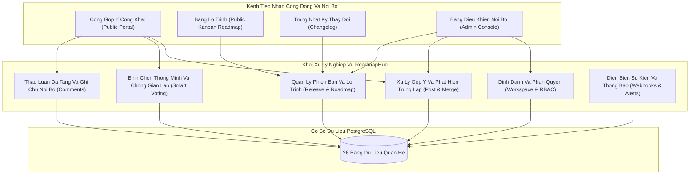
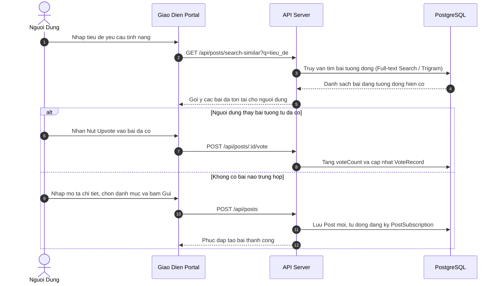
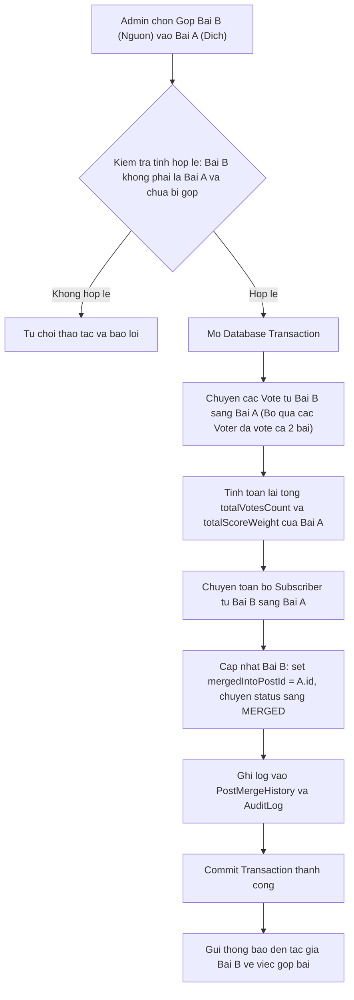
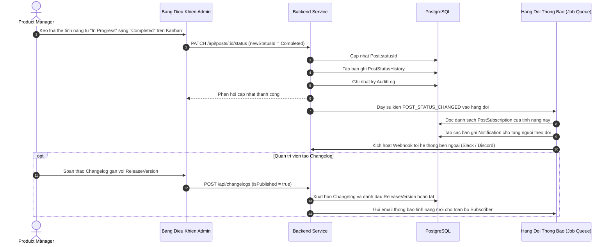

<br />

# TÀI LIỆU Ý TƯỞNG THIẾT KẾ VÀ KIẾN TRÚC HỆ THỐNG ROADMAPHUB

Hệ thống Quản lý Vòng đời Góp ý, Lộ trình Tính năng và Bảng Phát hành Tập trung (Product Feedback & Roadmap Platform).

---

## 1. TỔNG QUAN Ý TƯỞNG VÀ ĐỊNH VỊ SẢN PHẨM

### 1.1. Bối Cảnh Thực Tế Và Bài Toán Giải Quyết

Khi một sản phẩm phần mềm (SaaS, Mobile App, E-Commerce, Nền tảng nội bộ) đi vào vận hành thực tế, đội ngũ phát triển thường đối mặt với các vấn đề:

- **Góp ý phân mảnh:** Ý kiến người dùng rải rác qua email hỗ trợ, tin nhắn mạng xã hội, diễn đàn, nhóm chat cộng đồng, khiến các ý tưởng giá trị và báo lỗi nghiêm trọng bị thất lạc.
- **Thiếu dữ liệu định lượng để ưu tiên tính năng:** Đội ngũ sản phẩm (Product Manager / Tech Lead) gặp khó khăn trong việc xác định tính năng nào thực sự mang lại tác động lớn nhất cho số đông người dùng hoặc nhóm khách hàng doanh nghiệp trả phí cao.
- **Khoảng cách truyền thông:** Người dùng không biết tính năng mình yêu cầu có được tiếp nhận hay không, dẫn đến cảm giác không được lắng nghe; trong khi đội ngũ phát triển lại tốn nhiều thời gian trả lời lặp đi lặp lại cùng một câu hỏi về tiến độ.

**RoadmapHub** giải quyết bài toán trên bằng cách thiết lập một cổng tương tác hai chiều minh bạch:

- Cho phép người dùng đề xuất, thảo luận và bỏ phiếu (Upvote) cho các tính năng mong muốn.
- Hỗ trợ đội ngũ sản phẩm phân loại, gộp các bài trùng lặp, đánh giá mức độ ưu tiên và đưa tính năng vào lộ trình phát triển.
- Công khai bảng lộ trình (Roadmap Kanban) và tự động thông báo tiến độ đến từng người dùng đã theo dõi khi tính năng được phát hành cùng nhật ký thay đổi (Changelog).

### 1.2. Định Vị Quy Mô So Với Hệ Thống Mẫu EL-TECH

Hệ thống thương mại điện tử linh kiện máy tính EL-TECH sở hữu 42 bảng dữ liệu bao gồm các nghiệp vụ phức tạp về sổ cái kho (Stock Ledger), cấu hình máy tính ảo (Virtual PC BOM), quản lý chi nhánh đơn lẻ và thanh toán tài chính.

Để đáp ứng quy mô khoảng **50% độ phức tạp của EL-TECH**, RoadmapHub được thiết kế với **26 bảng dữ liệu (models)** chuẩn PostgreSQL/Prisma, tập trung vào:

- Kiến trúc đa tổ chức (Multi-tenant Workspace) cho phép một tài khoản quản lý nhiều sản phẩm hoặc thương hiệu.
- Động cơ vòng đời tính năng (Feature Lifecycle Engine) với trạng thái tùy biến và lịch sử kiểm toán thay đổi.
- Cơ chế gộp bài trùng lặp (Post Merge Engine) bảo toàn số phiếu bầu và người đăng ký.
- Hệ thống bình chọn thông minh có tính toán trọng số theo cấp bậc người dùng và thuật toán chống gian lận (Anti-Spam / Fraud Detection).
- Bình luận phân cấp đa tầng (Nested Comments) phân tách giữa thảo luận cộng đồng và ghi chú kỹ thuật nội bộ (Private Team Notes).
- Quản lý phiên bản phát hành (Release Management), bảng lộ trình trực quan và xuất bản nhật ký thay đổi (Changelog).
- Webhook sự kiện và hệ thống thông báo đa kênh (In-app, Email).

---

## 2. NGUYÊN TẮC BẤT BIẾN NGHIỆP VỤ (CORE INVARIANTS)

1. **Nguyên Tắc Đơn Nhất Lượt Bình Chọn (Single Vote Invariant):**
   Mỗi định danh người dùng (User ID hoặc Voter Profile) chỉ được sở hữu duy nhất 1 lượt bình chọn hợp lệ trên mỗi bài đăng tại một thời điểm. Thao tác bỏ phiếu lại sẽ đóng vai trò hủy bình chọn (Toggle/Unvote). Tổng số vote trên bảng `Post` được cập nhật nguyên tử thông qua giao dịch cơ sở dữ liệu.
2. **Nguyên Tắc Bảo Toàn Lịch Sử Và Gộp Bài (Immutable Post Merge Invariant):**
   Khi bài viết B bị gộp vào bài viết A do trùng lặp, bài viết B không bị xóa khỏi cơ sở dữ liệu mà chuyển trạng thái sang `MERGED`, trỏ khóa ngoại về bài viết A. Toàn bộ người bình chọn và người theo dõi từ bài viết B được chuyển nhượng sang bài viết A (trừ những người đã vote ở bài viết A để tránh trùng lặp).
3. **Nguyên Tắc Phân Lập Không Gian Làm Việc (Tenant Isolation Invariant):**
   Mọi dữ liệu thuộc về bài đăng, danh mục, bình luận, lộ trình và phiên bản phát hành đều phải được ràng buộc chặt chẽ với một `workspace_id`. Quyền hạn quản trị viên chỉ có hiệu lực trong phạm vi không gian làm việc mà họ được cấp quyền.
4. **Nguyên Tắc Phân Tách Minh Bạch Thảo Luận Công Khai Và Ghi Chú Nội Bộ (Public vs Internal Note Invariant):**
   Bình luận được đánh dấu cờ `is_internal_note = true` tuyệt đối không được tuần tự hóa gửi về client trong các truy vấn công khai của người dùng thông thường; chỉ các thành viên nội bộ (Admin, Product Manager, Developer) có quyền hạn hợp lệ mới được đọc và phản hồi.
5. **Nguyên Tắc Đồng Bộ Trạng Thái Lộ Trình (Roadmap State-to-Subscriber Sync Invariant):**
   Khi một bài đăng được chuyển sang trạng thái mới trên bảng Kanban (ví dụ từ `IN_PROGRESS` sang `COMPLETED`), hệ thống bắt buộc phải tự động tạo bản ghi lịch sử trạng thái (`PostStatusHistory`) và kích hoạt hàng đợi thông báo tới toàn bộ người dùng đã bình chọn hoặc theo dõi bài đăng đó.

---

## 3. CÁC PHÂN HỆ NGHIỆP VỤ CỐT LÕI



### 3.1. Phân Hệ 1: Quản Trị Không Gian Làm Việc Và Định Danh (Workspace & Identity)

- **Đa không gian làm việc:** Hỗ trợ tạo nhiều Workspace độc lập tương ứng với các sản phẩm khác nhau. Mỗi Workspace có tên miền riêng, cấu hình logo, bảng màu và cài đặt quy tắc cộng đồng.
- **Phân quyền vai trò nội bộ (RBAC):** Định nghĩa các vai trò gồm Chủ sở hữu (Owner), Quản trị viên (Admin), Quản lý sản phẩm (Product Manager), Lập trình viên (Developer) và Kiểm duyệt viên (Moderator).
- **Hồ sơ định danh linh hoạt (Voter Profile):** Cho phép người dùng cuối tương tác qua ba cơ chế:
  - Đăng nhập tài khoản hệ thống (Email/Password hoặc OAuth).
  - Định danh qua Single Sign-On (SSO / JWT) tích hợp trực tiếp từ ứng dụng của khách hàng.
  - Tương tác ẩn danh được bảo vệ bằng mã băm vân tay trình duyệt (Device Fingerprint + IP Salt) để phòng chống việc spam bình chọn.

### 3.2. Phân Hệ 2: Cấu Trúc Bảng Phản Hồi, Danh Mục Và Gắn Thẻ (Boards, Categories & Tags)

- **Bảng chuyên đề (Boards):** Phân chia khu vực phản hồi theo mục đích (ví dụ: Tính năng cốt lõi, Ứng dụng di động, Báo cáo lỗi, Cổng kết nối tích hợp). Mỗi bảng có cờ công khai, yêu cầu kiểm duyệt trước khi hiển thị hoặc giới hạn quyền tạo bài.
- **Danh mục chức năng (Categories):** Phân cấp theo phòng ban hoặc mảng kỹ thuật (UI/UX, Backend, Database, Hiệu năng, Bảo mật).
- **Hệ thống nhãn linh hoạt (Tags):** Gắn nhãn cho bài viết nhằm mục đích lọc và quản trị (ví dụ: Q1-Goal, High-Impact, Enterprise-Request, Quick-Win).

### 3.3. Phân Hệ 3: Vòng Đời Yêu Cầu Và Động Cơ Gộp Bài Trùng Lặp (Post Lifecycle & Merge Engine)

- **Trạng thái tùy biến động (Custom Post Statuses):** Cho phép quản trị viên tự định nghĩa quy trình xử lý tính năng (Đang xem xét, Đã tiếp nhận, Lên kế hoạch, Đang thực hiện, Đang thử nghiệm, Đã phát hành, Từ chối).
- **Động cơ gộp bài (Post Merge Engine):** Khi có nhiều người dùng gửi cùng một yêu cầu bằng các câu từ khác nhau, quản trị viên thực hiện thao tác gộp bài viết con vào bài viết cha. Toàn bộ người bình chọn, người theo dõi và bình luận được liên kết hợp nhất sang bài viết chính, đồng thời lưu lịch sử kiểm toán gộp bài.
- **Tệp đính kèm và tài liệu:** Hỗ trợ người dùng tải lên hình ảnh minh họa, tài liệu đặc tả hoặc ảnh chụp màn hình lỗi.

### 3.4. Phân Hệ 4: Bình Chọn Thông Minh Và Thảo Luận Đa Tầng (Smart Voting & Nested Discussions)

- **Trọng số bình chọn (Vote Weighting):** Hỗ trợ tính điểm ưu tiên dựa trên giá trị khách hàng (ví dụ: Người dùng miễn phí tương đương 1 điểm, khách hàng Pro tương đương 3 điểm, khách hàng Enterprise ký hợp đồng lớn tương đương 10 điểm).
- **Nhật ký biến động bình chọn:** Ghi nhận mọi hành vi upvote/unvote kèm IP Hash để phát hiện đột biến lưu lượng bất thường hoặc hành vi tạo tài khoản ảo để thao túng thứ hạng.
- **Cấu trúc bình luận dạng cây (Threaded Comments):** Hỗ trợ thảo luận đa cấp, trích dẫn phản hồi.
- **Ghi chú nội bộ bí mật (Private Team Notes):** Các thành viên phát triển có thể thảo luận kỹ thuật, ước lượng độ khó ngay trên bài đăng của khách hàng mà người dùng bên ngoài không nhìn thấy.

### 3.5. Phân Hệ 5: Bảng Lộ Trình Tương Tác, Quản Lý Phiên Bản Và Changelog

- **Bảng Kanban lộ trình công khai:** Hiển thị tiến độ phát triển sản phẩm theo các cột trạng thái đã chọn. Người dùng có thể lọc theo bảng hoặc danh mục.
- **Góc nhìn lộ trình đa dạng (Roadmap Views):** Hỗ trợ hiển thị theo dạng cột Kanban tiến độ hoặc theo các mốc thời gian quý (Q1, Q2, Q3) hoặc Sprint phát hành.
- **Quản lý phiên bản phát hành (Release Versions):** Gom các tính năng đã hoàn thành vào một phiên bản cụ thể (ví dụ: Release v2.4.0).
- **Nhật ký phát hành chính thức (Public Changelog):** Khi phát hành phiên bản, hệ thống xuất bản trang bài viết thông báo tính năng mới kèm danh sách các phản hồi đã được đóng góp và giải quyết.

### 3.6. Phân Hệ 6: Thông Báo, Tích Hợp Và Sổ Kiểm Toán (Subscriptions, Webhooks & Audit)

- **Đăng ký nhận tin tự động (Auto-Subscription):** Bất kỳ người dùng nào gửi bài, bình luận hoặc upvote một tính năng sẽ tự động được đưa vào danh sách theo dõi để nhận thông báo khi trạng thái tính năng thay đổi.
- **Hộp thư thông báo trong ứng dụng (In-app Notifications):** Báo cho người dùng khi có câu trả lời từ đội ngũ phát triển hoặc tính năng đã hoàn thành.
- **Webhook sự kiện hai chiều:** Phát sự kiện đến các công cụ bên ngoài (Slack, Discord, Jira, GitHub) khi có phản hồi mới hoặc khi tính năng chuyển sang trạng thái cần lập trình.
- **Sổ kiểm toán quản trị (Audit Log):** Lưu trữ bất biến các hành động của nhân viên quản trị (đổi trạng thái, xóa bài, ẩn bình luận, cấp quyền).

---

## 4. CHI TIẾT THIẾT KẾ CƠ SỞ DỮ LIỆU (POSTGRESQL & PRISMA)

Cấu trúc gồm **26 bảng** dữ liệu quan hệ, tuân thủ nghiêm ngặt các quy tắc:

- Bảng ở dạng số ít PascalCase trong Prisma, ánh xạ sang bảng `snake_case` trong cơ sở dữ liệu.
- Mọi bảng đều có khóa chính `id`, các bảng có thể thay đổi dữ liệu đều có bộ ba trường kiểm toán `isActive`, `createdAt`, `updatedAt` ở cuối.
- Dùng `Decimal` cho các trường tính toán trọng số/điểm ưu tiên, `Text` cho nội dung văn bản dài, `Json` cho dữ liệu cấu hình linh hoạt.

### 4.1. Danh Sách 26 Mô Hình Dữ Liệu Theo Phân Nhóm

| STT | Tên Model Prisma      | Tên Bảng Database       | Mục Đích Lưu Trữ                                         |
| :-- | :-------------------- | :---------------------- | :------------------------------------------------------- |
| 1   | `Workspace`           | `workspaces`            | Không gian làm việc của tổ chức/sản phẩm                 |
| 2   | `WorkspaceMember`     | `workspace_members`     | Nhân sự nội bộ và phân quyền trong Workspace             |
| 3   | `User`                | `users`                 | Tài khoản người dùng hệ thống                            |
| 4   | `UserSession`         | `user_sessions`         | Quản lý phiên làm việc, thiết bị và token                |
| 5   | `VoterProfile`        | `voter_profiles`        | Hồ sơ định danh người bỏ phiếu (SSO/Ẩn danh)             |
| 6   | `Board`               | `boards`                | Bảng phản hồi theo chủ đề (Feature, Bug, Mobile...)      |
| 7   | `Category`            | `categories`            | Danh mục kỹ thuật phân loại bài đăng                     |
| 8   | `Tag`                 | `tags`                  | Nhãn phân loại linh hoạt                                 |
| 9   | `PostTag`             | `post_tags`             | Liên kết nhiều-nhiều giữa Bài đăng và Nhãn               |
| 10  | `Post`                | `posts`                 | Bài đăng yêu cầu tính năng / báo lỗi                     |
| 11  | `PostStatus`          | `post_statuses`         | Danh mục trạng thái tùy biến cho vòng đời tính năng      |
| 12  | `PostStatusHistory`   | `post_status_histories` | Sổ nhật ký ghi vết chuyển trạng thái bài đăng            |
| 13  | `PostMergeHistory`    | `post_merge_histories`  | Lưu vết lịch sử gộp bài trùng lặp                        |
| 14  | `PostAttachment`      | `post_attachments`      | Tệp đính kèm, ảnh chụp màn hình minh họa                 |
| 15  | `Vote`                | `votes`                 | Lượt bình chọn bài đăng kèm trọng số                     |
| 16  | `VoteActivityLog`     | `vote_activity_logs`    | Nhật ký hành vi bỏ phiếu nhằm kiểm toán chống gian lận   |
| 17  | `Comment`             | `comments`              | Thảo luận đa tầng và ghi chú nội bộ                      |
| 18  | `CommentReaction`     | `comment_reactions`     | Phản ứng đánh giá trên bình luận                         |
| 19  | `RoadmapView`         | `roadmap_views`         | Cấu hình các góc nhìn lộ trình công khai/nội bộ          |
| 20  | `ReleaseVersion`      | `release_versions`      | Phiên bản phát hành sản phẩm                             |
| 21  | `ReleaseItem`         | `release_items`         | Liên kết tính năng thuộc về phiên bản phát hành nào      |
| 22  | `Changelog`           | `changelogs`            | Bài viết thông báo cập nhật tính năng mới                |
| 23  | `PostSubscription`    | `post_subscriptions`    | Danh sách người theo dõi để gửi thông báo tiến độ        |
| 24  | `Notification`        | `notifications`         | Hộp thư thông báo trong ứng dụng cho người dùng          |
| 25  | `WebhookSubscription` | `webhook_subscriptions` | Cấu hình webhook phát sự kiện ra hệ thống ngoài          |
| 26  | `AuditLog`            | `audit_logs`            | Sổ kiểm toán ghi lại thao tác nhạy cảm của quản trị viên |

---

### 4.2. Mã Nguồn Đặc Tả Prisma Schema

```prisma
datasource db {
  provider = "postgresql"
  url      = env("DATABASE_URL")
}

generator client {
  provider = "prisma-client-js"
}

// Khai bao cac kieu liet ke trang thai va quyen han

enum WorkspaceRole {
  OWNER
  ADMIN
  PRODUCT_MANAGER
  DEVELOPER
  MODERATOR
}

enum VoterAuthType {
  REGISTERED
  SSO_IDENTIFIED
  ANONYMOUS_FINGERPRINT
}

enum StatusCategory {
  BACKLOG
  UNSCHEDULED
  PLANNED
  IN_PROGRESS
  COMPLETED
  CLOSED
  DECLINED
}

enum ReactionType {
  THUMBS_UP
  THUMBS_DOWN
  HEART
  ROCKET
  INSIGHTFUL
}

enum NotificationType {
  STATUS_CHANGED
  NEW_COMMENT
  OFFICIAL_RESPONSE
  FEATURE_RELEASED
  MENTIONED
}

enum WebhookEvent {
  POST_CREATED
  POST_STATUS_CHANGED
  POST_MERGED
  COMMENT_ADDED
  RELEASE_PUBLISHED
}

// -------------------------------------------------------------
// NHOM 1: KHONG GIAN LAM VIEC VA DINH DANH (MODELS 1 - 5)
// -------------------------------------------------------------

model Workspace {
  id               String                 @id @default(uuid())
  name             String
  slug             String                 @unique
  customDomain     String?                @unique @map("custom_domain")
  brandingConfig   Json                   @default("{}") @map("branding_config")
  isPublicPortal   Boolean                @default(true) @map("is_public_portal")
  members          WorkspaceMember[]
  boards           Board[]
  statuses         PostStatus[]
  roadmapViews     RoadmapView[]
  releaseVersions  ReleaseVersion[]
  changelogs       Changelog[]
  webhooks         WebhookSubscription[]
  auditLogs        AuditLog[]
  voterProfiles    VoterProfile[]

  isActive         Boolean                @default(true) @map("is_active")
  createdAt        DateTime               @default(now()) @map("created_at")
  updatedAt        DateTime               @updatedAt @map("updated_at")

  @@map("workspaces")
}

model User {
  id               String                 @id @default(uuid())
  email            String                 @unique
  fullName         String                 @map("full_name")
  avatarUrl        String?                @map("avatar_url")
  passwordHash     String?                @map("password_hash")
  memberships      WorkspaceMember[]
  sessions         UserSession[]
  authoredPosts    Post[]                 @relation("UserAuthoredPosts")
  comments         Comment[]
  statusUpdates    PostStatusHistory[]    @relation("StatusUpdatedByUser")
  auditLogs        AuditLog[]
  notifications    Notification[]

  isActive         Boolean                @default(true) @map("is_active")
  createdAt        DateTime               @default(now()) @map("created_at")
  updatedAt        DateTime               @updatedAt @map("updated_at")

  @@map("users")
}

model WorkspaceMember {
  id          Int            @id @default(autoincrement())
  workspaceId String         @map("workspace_id")
  userId      String         @map("user_id")
  role        WorkspaceRole  @default(DEVELOPER)

  workspace   Workspace      @relation(fields: [workspaceId], references: [id], onDelete: Cascade)
  user        User           @relation(fields: [userId], references: [id], onDelete: Cascade)

  isActive    Boolean        @default(true) @map("is_active")
  createdAt   DateTime       @default(now()) @map("created_at")
  updatedAt   DateTime       @updatedAt @map("updated_at")

  @@unique([workspaceId, userId])
  @@map("workspace_members")
}

model UserSession {
  id           String    @id @default(uuid())
  userId       String    @map("user_id")
  tokenHash    String    @unique @map("token_hash")
  ipAddress    String?   @map("ip_address")
  userAgent    String?   @map("user_agent")
  expiresAt    DateTime  @map("expires_at")

  user         User      @relation(fields: [userId], references: [id], onDelete: Cascade)

  createdAt    DateTime  @default(now()) @map("created_at")

  @@map("user_sessions")
}

model VoterProfile {
  id             String            @id @default(uuid())
  workspaceId    String            @map("workspace_id")
  authType       VoterAuthType     @default(REGISTERED) @map("auth_type")
  externalUserId String?           @map("external_user_id")
  displayName    String            @map("display_name")
  email          String?
  fingerprintHash String?          @map("fingerprint_hash")
  customerTier   String            @default("standard") @map("customer_tier")
  voteWeight     Decimal           @default(1.00) @map("vote_weight") @db.Decimal(5, 2)

  workspace      Workspace         @relation(fields: [workspaceId], references: [id], onDelete: Cascade)
  votes          Vote[]
  voteLogs       VoteActivityLog[]
  subscriptions  PostSubscription[]

  isActive       Boolean           @default(true) @map("is_active")
  createdAt      DateTime          @default(now()) @map("created_at")
  updatedAt      DateTime          @updatedAt @map("updated_at")

  @@unique([workspaceId, externalUserId])
  @@index([workspaceId, fingerprintHash])
  @@map("voter_profiles")
}

// -------------------------------------------------------------
// NHOM 2: CAU TRUC BANG PHAN HOI VA PHAN LOAI (MODELS 6 - 9)
// -------------------------------------------------------------

model Board {
  id            String       @id @default(uuid())
  workspaceId   String       @map("workspace_id")
  name          String
  slug          String
  description   String?      @db.Text
  isPublic      Boolean      @default(true) @map("is_public")
  isModerated   Boolean      @default(false) @map("is_moderated")
  displayOrder  Int          @default(0) @map("display_order")

  workspace     Workspace    @relation(fields: [workspaceId], references: [id], onDelete: Cascade)
  categories    Category[]
  posts         Post[]

  isActive      Boolean      @default(true) @map("is_active")
  createdAt     DateTime     @default(now()) @map("created_at")
  updatedAt     DateTime     @updatedAt @map("updated_at")

  @@unique([workspaceId, slug])
  @@map("boards")
}

model Category {
  id           Int          @id @default(autoincrement())
  boardId      String       @map("board_id")
  name         String
  slug         String
  description  String?
  displayOrder Int          @default(0) @map("display_order")

  board        Board        @relation(fields: [boardId], references: [id], onDelete: Cascade)
  posts        Post[]

  isActive     Boolean      @default(true) @map("is_active")
  createdAt    DateTime     @default(now()) @map("created_at")
  updatedAt    DateTime     @updatedAt @map("updated_at")

  @@unique([boardId, slug])
  @@map("categories")
}

model Tag {
  id           Int          @id @default(autoincrement())
  name         String
  slug         String       @unique
  colorHex     String       @default("#6B7280") @map("color_hex")
  posts        PostTag[]

  isActive     Boolean      @default(true) @map("is_active")
  createdAt    DateTime     @default(now()) @map("created_at")
  updatedAt    DateTime     @updatedAt @map("updated_at")

  @@map("tags")
}

model PostTag {
  postId       String       @map("post_id")
  tagId        Int          @map("tag_id")

  post         Post         @relation(fields: [postId], references: [id], onDelete: Cascade)
  tag          Tag          @relation(fields: [tagId], references: [id], onDelete: Cascade)

  createdAt    DateTime     @default(now()) @map("created_at")

  @@id([postId, tagId])
  @@map("post_tags")
}

// -------------------------------------------------------------
// NHOM 3: VONG DOI YEU CAU TINH NANG (MODELS 10 - 14)
// -------------------------------------------------------------

model PostStatus {
  id             Int              @id @default(autoincrement())
  workspaceId    String           @map("workspace_id")
  name           String
  key            String
  category       StatusCategory   @default(BACKLOG)
  colorHex       String           @default("#3B82F6") @map("color_hex")
  showOnRoadmap  Boolean          @default(false) @map("show_on_roadmap")
  displayOrder   Int              @default(0) @map("display_order")

  workspace      Workspace        @relation(fields: [workspaceId], references: [id], onDelete: Cascade)
  posts          Post[]
  sourceHistory  PostStatusHistory[] @relation("OldStatusRelation")
  targetHistory  PostStatusHistory[] @relation("NewStatusRelation")

  isActive       Boolean          @default(true) @map("is_active")
  createdAt      DateTime         @default(now()) @map("created_at")
  updatedAt      DateTime         @updatedAt @map("updated_at")

  @@unique([workspaceId, key])
  @@map("post_statuses")
}

model Post {
  id                 String               @id @default(uuid())
  boardId            String               @map("board_id")
  categoryId         Int?                 @map("category_id")
  statusId           Int                  @map("status_id")
  authorUserId       String?              @map("author_user_id")
  voterProfileId     String?              @map("voter_profile_id")
  title              String
  slug               String
  content            String               @db.Text
  totalVotesCount    Int                  @default(0) @map("total_votes_count")
  totalScoreWeight   Decimal              @default(0.00) @map("total_score_weight") @db.Decimal(10, 2)
  commentsCount      Int                  @default(0) @map("comments_count")
  isPinned           Boolean              @default(false) @map("is_pinned")
  isLocked           Boolean              @default(false) @map("is_locked")
  mergedIntoPostId   String?              @map("merged_into_post_id")

  board              Board                @relation(fields: [boardId], references: [id], onDelete: Cascade)
  category           Category?            @relation(fields: [categoryId], references: [id], onDelete: SetNull)
  status             PostStatus           @relation(fields: [statusId], references: [id], onDelete: Restrict)
  authorUser         User?                @relation("UserAuthoredPosts", fields: [authorUserId], references: [id], onDelete: SetNull)
  mergedTarget       Post?                @relation("MergedPosts", fields: [mergedIntoPostId], references: [id], onDelete: SetNull)
  mergedSources      Post[]               @relation("MergedPosts")

  tags               PostTag[]
  attachments        PostAttachment[]
  votes              Vote[]
  comments           Comment[]
  statusHistories    PostStatusHistory[]
  mergeHistoriesTo   PostMergeHistory[]   @relation("TargetPostMerges")
  mergeHistoriesFrom PostMergeHistory[]   @relation("SourcePostMerges")
  subscriptions      PostSubscription[]
  releaseItems       ReleaseItem[]

  isActive           Boolean              @default(true) @map("is_active")
  createdAt          DateTime             @default(now()) @map("created_at")
  updatedAt          DateTime             @updatedAt @map("updated_at")

  @@unique([boardId, slug])
  @@index([boardId, statusId])
  @@index([totalScoreWeight(sort: Desc)])
  @@map("posts")
}

model PostStatusHistory {
  id          Int         @id @default(autoincrement())
  postId      String      @map("post_id")
  oldStatusId Int?        @map("old_status_id")
  newStatusId Int         @map("new_status_id")
  changedById String?     @map("changed_by_id")
  changeNote  String?     @map("change_note") @db.Text

  post        Post        @relation(fields: [postId], references: [id], onDelete: Cascade)
  oldStatus   PostStatus? @relation("OldStatusRelation", fields: [oldStatusId], references: [id], onDelete: SetNull)
  newStatus   PostStatus  @relation("NewStatusRelation", fields: [newStatusId], references: [id], onDelete: Restrict)
  changedBy   User?       @relation("StatusUpdatedByUser", fields: [changedById], references: [id], onDelete: SetNull)

  createdAt   DateTime    @default(now()) @map("created_at")

  @@map("post_status_histories")
}

model PostMergeHistory {
  id             Int       @id @default(autoincrement())
  sourcePostId   String    @map("source_post_id")
  targetPostId   String    @map("target_post_id")
  performedById  String?   @map("performed_by_id")
  votesTransferred Int     @default(0) @map("votes_transferred")

  sourcePost     Post      @relation("SourcePostMerges", fields: [sourcePostId], references: [id], onDelete: Cascade)
  targetPost     Post      @relation("TargetPostMerges", fields: [targetPostId], references: [id], onDelete: Cascade)

  createdAt      DateTime  @default(now()) @map("created_at")

  @@map("post_merge_histories")
}

model PostAttachment {
  id          String    @id @default(uuid())
  postId      String    @map("post_id")
  fileName    String    @map("file_name")
  fileUrl     String    @map("file_url")
  fileSize    Int       @map("file_size")
  mimeType    String    @map("mime_type")

  post        Post      @relation(fields: [postId], references: [id], onDelete: Cascade)

  createdAt   DateTime  @default(now()) @map("created_at")

  @@map("post_attachments")
}

// -------------------------------------------------------------
// NHOM 4: BINH CHON VA THAO LUAN CONG DONG (MODELS 15 - 18)
// -------------------------------------------------------------

model Vote {
  id              Int          @id @default(autoincrement())
  postId          String       @map("post_id")
  voterProfileId  String       @map("voter_profile_id")
  appliedWeight   Decimal      @default(1.00) @map("applied_weight") @db.Decimal(5, 2)
  ipAddressHash   String?      @map("ip_address_hash")

  post            Post         @relation(fields: [postId], references: [id], onDelete: Cascade)
  voterProfile    VoterProfile @relation(fields: [voterProfileId], references: [id], onDelete: Cascade)

  createdAt       DateTime     @default(now()) @map("created_at")

  @@unique([postId, voterProfileId])
  @@map("votes")
}

model VoteActivityLog {
  id              Int          @id @default(autoincrement())
  postId          String       @map("post_id")
  voterProfileId  String       @map("voter_profile_id")
  actionType      String       @map("action_type")
  ipAddressHash   String?      @map("ip_address_hash")
  userAgent       String?      @map("user_agent")

  voterProfile    VoterProfile @relation(fields: [voterProfileId], references: [id], onDelete: Cascade)

  createdAt       DateTime     @default(now()) @map("created_at")

  @@map("vote_activity_logs")
}

model Comment {
  id              String            @id @default(uuid())
  postId          String            @map("post_id")
  authorUserId    String?           @map("author_user_id")
  parentId        String?           @map("parent_id")
  authorName      String            @map("author_name")
  content         String            @db.Text
  isInternalNote  Boolean           @default(false) @map("is_internal_note")
  isPinned        Boolean           @default(false) @map("is_pinned")

  post            Post              @relation(fields: [postId], references: [id], onDelete: Cascade)
  authorUser      User?             @relation(fields: [authorUserId], references: [id], onDelete: SetNull)
  parentComment   Comment?          @relation("NestedReplies", fields: [parentId], references: [id], onDelete: Cascade)
  replies         Comment[]         @relation("NestedReplies")
  reactions       CommentReaction[]

  isActive        Boolean           @default(true) @map("is_active")
  createdAt       DateTime          @default(now()) @map("created_at")
  updatedAt       DateTime          @updatedAt @map("updated_at")

  @@map("comments")
}

model CommentReaction {
  id          Int          @id @default(autoincrement())
  commentId   String       @map("comment_id")
  userId      String?      @map("user_id")
  voterId     String?      @map("voter_id")
  type        ReactionType

  comment     Comment      @relation(fields: [commentId], references: [id], onDelete: Cascade)

  createdAt   DateTime     @default(now()) @map("created_at")

  @@unique([commentId, userId, type])
  @@map("comment_reactions")
}

// -------------------------------------------------------------
// NHOM 5: LO TRINH, PHIEN BAN VA CHANGELOG (MODELS 19 - 22)
// -------------------------------------------------------------

model RoadmapView {
  id           Int         @id @default(autoincrement())
  workspaceId  String      @map("workspace_id")
  name         String
  slug         String
  isDefault    Boolean     @default(false) @map("is_default")
  columnConfig Json        @default("[]") @map("column_config")

  workspace    Workspace   @relation(fields: [workspaceId], references: [id], onDelete: Cascade)

  isActive     Boolean     @default(true) @map("is_active")
  createdAt    DateTime    @default(now()) @map("created_at")
  updatedAt    DateTime    @updatedAt @map("updated_at")

  @@unique([workspaceId, slug])
  @@map("roadmap_views")
}

model ReleaseVersion {
  id             String        @id @default(uuid())
  workspaceId    String        @map("workspace_id")
  versionName    String        @map("version_name")
  targetDate     DateTime?     @map("target_date")
  releasedAt     DateTime?     @map("released_at")
  isPublished    Boolean       @default(false) @map("is_published")

  workspace      Workspace     @relation(fields: [workspaceId], references: [id], onDelete: Cascade)
  items          ReleaseItem[]
  changelog      Changelog?

  isActive       Boolean       @default(true) @map("is_active")
  createdAt      DateTime      @default(now()) @map("created_at")
  updatedAt      DateTime      @updatedAt @map("updated_at")

  @@unique([workspaceId, versionName])
  @@map("release_versions")
}

model ReleaseItem {
  id               Int            @id @default(autoincrement())
  releaseVersionId String         @map("release_version_id")
  postId           String         @map("post_id")
  completedNote    String?        @map("completed_note")

  releaseVersion   ReleaseVersion @relation(fields: [releaseVersionId], references: [id], onDelete: Cascade)
  post             Post           @relation(fields: [postId], references: [id], onDelete: Cascade)

  createdAt        DateTime       @default(now()) @map("created_at")

  @@unique([releaseVersionId, postId])
  @@map("release_items")
}

model Changelog {
  id               String          @id @default(uuid())
  workspaceId      String          @map("workspace_id")
  releaseVersionId String?         @unique @map("release_version_id")
  title            String
  slug             String
  summary          String          @db.Text
  bodyMarkdown     String          @map("body_markdown") @db.Text
  isPublished      Boolean         @default(false) @map("is_published")
  publishedAt      DateTime?       @map("published_at")

  workspace        Workspace       @relation(fields: [workspaceId], references: [id], onDelete: Cascade)
  releaseVersion   ReleaseVersion? @relation(fields: [releaseVersionId], references: [id], onDelete: SetNull)

  isActive         Boolean         @default(true) @map("is_active")
  createdAt        DateTime        @default(now()) @map("created_at")
  updatedAt        DateTime        @updatedAt @map("updated_at")

  @@unique([workspaceId, slug])
  @@map("changelogs")
}

// -------------------------------------------------------------
// NHOM 6: THONG BAO, WEBHOOK VA KIEM TOAN (MODELS 23 - 26)
// -------------------------------------------------------------

model PostSubscription {
  id             Int          @id @default(autoincrement())
  postId         String       @map("post_id")
  voterProfileId String       @map("voter_profile_id")
  notifyEmail    Boolean      @default(true) @map("notify_email")
  notifyInApp    Boolean      @default(true) @map("notify_in_app")

  post           Post         @relation(fields: [postId], references: [id], onDelete: Cascade)
  voterProfile   VoterProfile @relation(fields: [voterProfileId], references: [id], onDelete: Cascade)

  createdAt      DateTime     @default(now()) @map("created_at")

  @@unique([postId, voterProfileId])
  @@map("post_subscriptions")
}

model Notification {
  id          String           @id @default(uuid())
  userId      String           @map("user_id")
  type        NotificationType
  title       String
  message     String           @db.Text
  actionUrl   String?          @map("action_url")
  isRead      Boolean          @default(false) @map("is_read")

  user        User             @relation(fields: [userId], references: [id], onDelete: Cascade)

  createdAt   DateTime         @default(now()) @map("created_at")

  @@index([userId, isRead])
  @@map("notifications")
}

model WebhookSubscription {
  id          String       @id @default(uuid())
  workspaceId String       @map("workspace_id")
  targetUrl   String       @map("target_url")
  secretKey   String       @map("secret_key")
  events      WebhookEvent[]

  workspace   Workspace    @relation(fields: [workspaceId], references: [id], onDelete: Cascade)

  isActive    Boolean      @default(true) @map("is_active")
  createdAt   DateTime     @default(now()) @map("created_at")
  updatedAt   DateTime     @updatedAt @map("updated_at")

  @@map("webhook_subscriptions")
}

model AuditLog {
  id          Int       @id @default(autoincrement())
  workspaceId String    @map("workspace_id")
  userId      String?   @map("user_id")
  action      String
  entityType  String    @map("entity_type")
  entityId    String    @map("entity_id")
  details     Json      @default("{}")
  ipAddress   String?   @map("ip_address")

  workspace   Workspace @relation(fields: [workspaceId], references: [id], onDelete: Cascade)
  user        User?     @relation(fields: [userId], references: [id], onDelete: SetNull)

  createdAt   DateTime  @default(now()) @map("created_at")

  @@index([workspaceId, entityType, entityId])
  @@map("audit_logs")
}
```

---

## 5. CÁC LUỒNG XỬ LÝ NGHIỆP VỤ NÂNG CAO

### 5.1. Luồng Gửi Yêu Cầu Và Phát Hiện Bài Trùng Lặp Tự Động (Deduplication Workflow)



### 5.2. Luồng Bình Chọn Thông Minh Và Tính Trọng Số (Smart Voting Flow)

- Khi một lượt vote được gửi lên:
  - Hệ thống kiểm tra bảng `VoterProfile` của người dùng để xác định `voteWeight` (ví dụ: tài khoản Enterprise có trọng số `5.00`, người dùng thông thường có trọng số `1.00`).
  - Thực hiện giao dịch nguyên tử (Atomic Database Transaction):
    - Kiểm tra xem bản ghi `Vote` giữa `(postId, voterProfileId)` đã tồn tại hay chưa.
    - Nếu chưa tồn tại: Tạo bản ghi `Vote`, đồng thời cộng `totalVotesCount = totalVotesCount + 1` và `totalScoreWeight = totalScoreWeight + voteWeight`.
    - Nếu đã tồn tại: Xóa bản ghi `Vote`, đồng thời trừ `totalVotesCount = totalVotesCount - 1` và `totalScoreWeight = totalScoreWeight - voteWeight`.
    - Ghi nhận lịch sử vào `VoteActivityLog` để phục vụ phân tích chống bot.

### 5.3. Luồng Gộp Bài Viết Trùng Lặp (Post Merge Engine)



### 5.4. Luồng Chuyển Trạng Thái Lộ Trình Và Phát Hành Changelog



---

## 6. MA TRẬN SO SÁNH VÀ ĐÁNH GIÁ ĐỘ PHỨC TẠP

| Tiêu Chí So Sánh               | Hệ Thống Tham Chiếu EL-TECH (100%)                                                                                                                            | Hệ Thống Đề Xuất RoadmapHub (Cỡ 50%)                                                                                                                                                   |
| :----------------------------- | :------------------------------------------------------------------------------------------------------------------------------------------------------------ | :------------------------------------------------------------------------------------------------------------------------------------------------------------------------------------- |
| **Số lượng bảng dữ liệu**      | 42 bảng                                                                                                                                                       | 26 bảng                                                                                                                                                                                |
| **Phạm vi nghiệp vụ**          | Bán lẻ đa kênh, quản lý kho đa chi nhánh, cấu hình PC Virtual BOM, tính giá khuyến mãi tầng, đối soát thanh toán QR/COD, quản lý nhà cung cấp và nhập kho PO. | Quản lý vòng đời tính năng, bảng lộ trình Kanban, gộp phản hồi trùng lặp, bình chọn có trọng số, thảo luận đa tầng và ghi chú nội bộ, quản lý phiên bản phát hành và nhật ký thay đổi. |
| **Mô hình người dùng**         | Khách hàng vãng lai (Guest checkout), Khách hàng thành viên, Nhân viên cửa hàng, Quản lý kho, Quản trị viên hệ thống.                                         | Khách vãng lai xác thực qua Device Fingerprint, Người dùng đăng ký, Khách hàng xác thực qua JWT SSO ngoài, Quản trị viên nội bộ (Admin/PM/Dev).                                        |
| **Tính toán và logic cốt lõi** | Tính giá khuyến mãi, công suất nguồn máy tính, kiểm tra tương thích phần cứng, phân bổ xuất kho đơn chi nhánh.                                                | Tính tổng trọng số điểm ưu tiên, thuật toán kiểm tra bài tương đồng, hợp nhất dữ liệu gộp bài (Merge), phân quyền bình luận nội bộ.                                                    |
| **Hệ thống kiểm toán**         | Sổ cái kho bất biến (Stock Ledger Entry), Lịch sử trạng thái đơn hàng (Order Status History).                                                                 | Sổ lịch sử trạng thái bài đăng (Post Status History), Nhật ký biến động bỏ phiếu (Vote Activity Log), Lịch sử gộp bài (Post Merge History), Sổ kiểm toán quản trị (Audit Log).         |
| **Tích hợp bên ngoài**         | Cổng thanh toán chuyển khoản quét mã QR, Đơn vị vận chuyển giao hàng COD.                                                                                     | Webhook phát sự kiện ra công cụ quản lý dự án (Jira, GitHub, Slack, Discord), SSO Token từ sản phẩm của khách hàng.                                                                    |

---

## 7. ĐỀ XUẤT CÔNG NGHỆ VÀ LỘ TRÌNH TRIỂN KHAI

### 7.1. Ngăn Xếp Công Nghệ Khuyến Nghị (Tech Stack Alignment)

- **Frontend:**
  - Angular 22 (Standalone Components, Signals Store, Angular CDK).
  - Tailwind CSS kết hợp thư viện Spartan UI (`spartan/ui`) kế thừa chuẩn thiết kế cao cấp, độ tương phản sắc nét.
  - Thư viện kéo thả CDK Drag-and-Drop cho bảng Kanban Lộ trình.
  - Zod và Angular Reactive Forms cho biểu mẫu gửi ý kiến và quản trị trạng thái.
- **Backend:**
  - Node.js (Fastify hoặc Express với TypeScript chế độ Strict).
  - Prisma ORM làm việc với cơ sở dữ liệu PostgreSQL.
  - Better-Auth phục vụ định danh tài khoản nội bộ và xác thực token SSO từ hệ thống ngoài.
- **Cơ sở dữ liệu & Tìm kiếm:**
  - PostgreSQL (Supabase hoặc Self-hosted).
  - Sử dụng tiện ích mở rộng `pg_trgm` của PostgreSQL để hỗ trợ tìm kiếm toàn văn và gợi ý các bài đăng trùng lặp tức thì theo độ tương đồng chuỗi ký tự.

### 7.2. Lộ Trình Triển Khai Theo Giai Đoạn (Phasing)

- **Giai đoạn 1: Nền Tảng Cốt Lõi Và Tiếp Nhận Góp Ý (Feedback Engine MVP)**
  - Khởi tạo 9 bảng dữ liệu đầu tiên: `Workspace`, `User`, `WorkspaceMember`, `VoterProfile`, `Board`, `Category`, `PostStatus`, `Post`, `Vote`.
  - Triển khai cổng công khai cho phép gửi bài, tìm kiếm bài, bỏ phiếu bình chọn cơ bản và phân trang.
  - Bảng điều khiển quản trị viên đơn giản để duyệt và chuyển trạng thái bài đăng.

- **Giai đoạn 2: Lộ Trình Kanban, Thảo Luận Đa Tầng Và Quản Lý Trùng Lặp (Collaboration & Roadmapping)**
  - Mở rộng thêm 9 bảng tiếp theo: `Tag`, `PostTag`, `PostStatusHistory`, `PostMergeHistory`, `PostAttachment`, `VoteActivityLog`, `Comment`, `CommentReaction`, `RoadmapView`.
  - Xây dựng giao diện Kanban kéo thả trực quan theo trạng thái trên bảng lộ trình công khai.
  - Triển khai tính năng gộp bài trùng lặp (Post Merge Engine) và phân cấp bình luận (thảo luận công khai song song với ghi chú nội bộ cho lập trình viên).
  - Áp dụng cơ chế tính trọng số bình chọn theo cấp bậc khách hàng.

- **Giai đoạn 3: Phát Hành Sản Phẩm, Tích Hợp Và Quản Trị Doanh Nghiệp (Release Management & Enterprise Readiness)**
  - Hoàn thiện 8 bảng cuối cùng: `ReleaseVersion`, `ReleaseItem`, `Changelog`, `PostSubscription`, `Notification`, `WebhookSubscription`, `AuditLog`, `UserSession`.
  - Triển khai trang phát hành nhật ký thay đổi (Changelog) gắn liền với phiên bản.
  - Tự động hóa gửi thông báo đa kênh đến người dùng khi tính năng hoàn thành.
  - Xây dựng hệ thống Webhook liên kết với Jira/Slack và sổ nhật ký kiểm toán hành vi của quản trị viên.
